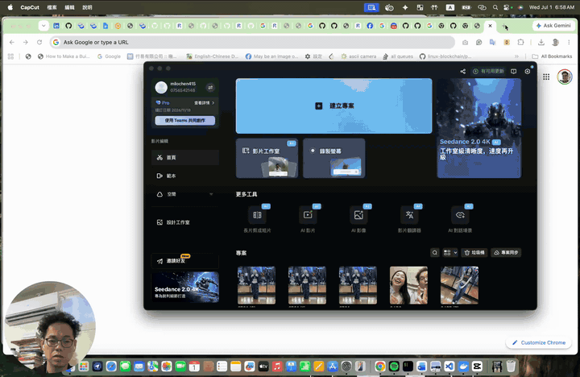
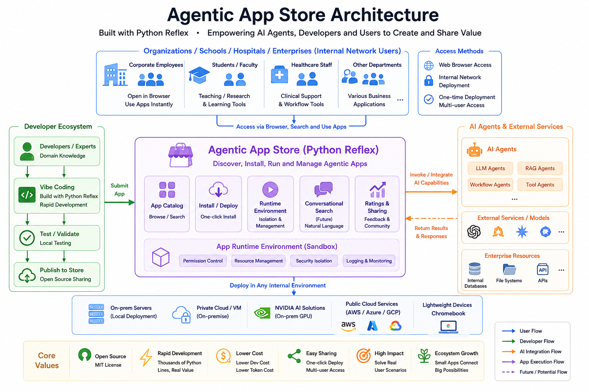
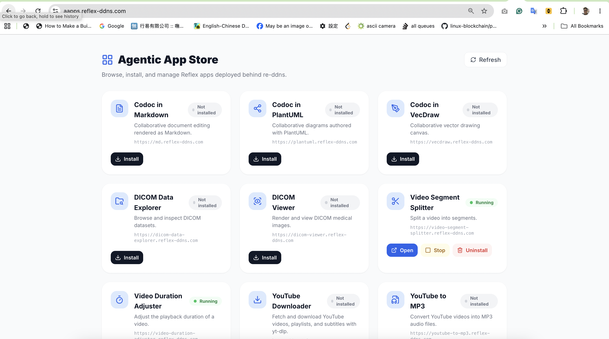
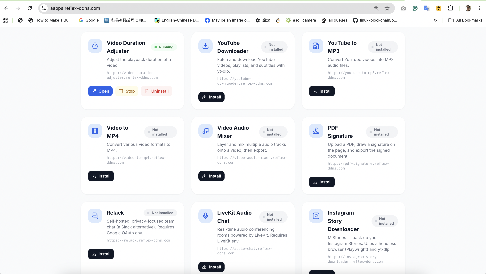
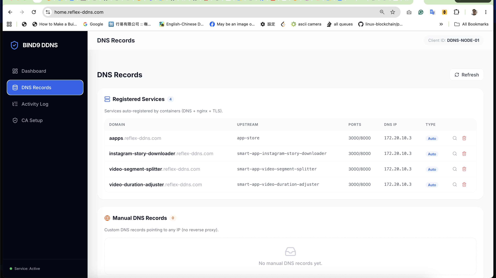
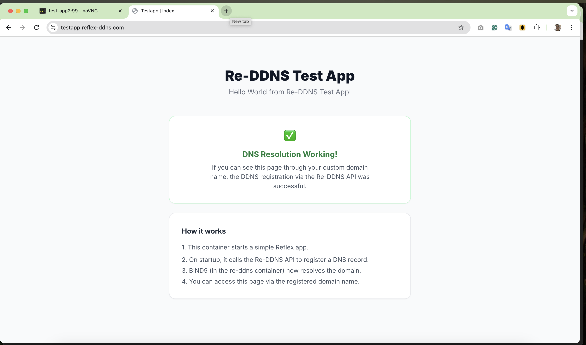
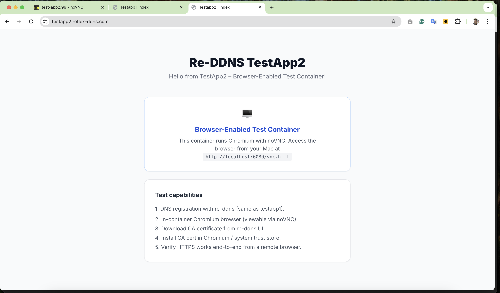
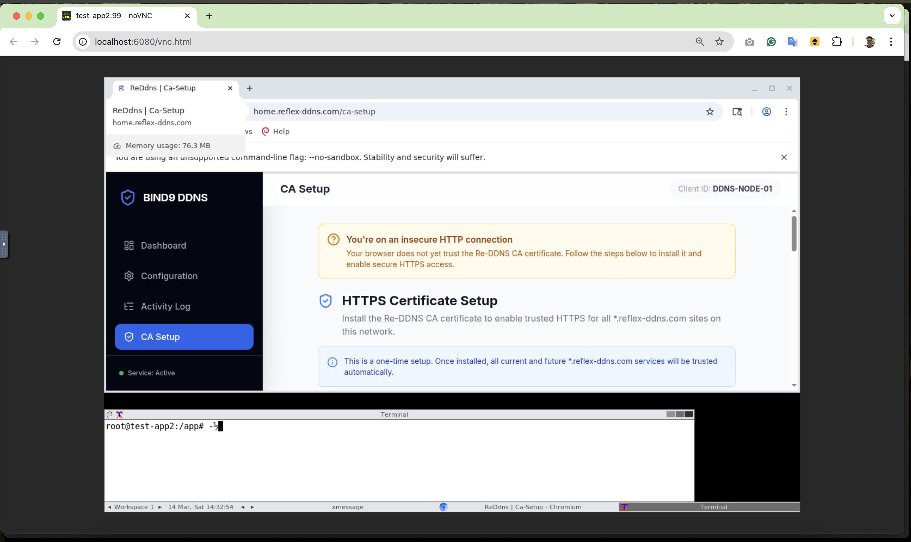

# PyCon TW 2026 Sprint Guide for the project

[Dev Databricks x Reflex app for agentic app store of re_ddns](https://hackmd.io/@milochen0418/PyCon-TW-2026-Sprint-Guide)

# Re-DDNS — Private HTTPS Infrastructure + Agentic App Store

> **TL;DR** — Run one script. Get a local HTTPS network where every Reflex app gets its own `https://<name>.reflex-ddns.com` with a green padlock. Then open the **Agentic App Store** and install apps from GitHub in one click — no shell commands needed.

> Before working on this project, read [AGENTS.md](AGENTS.md) for required workflows and tooling expectations.

---

## Vision

I hope the Agentic App Store can grow from an open-source community into a **decentralized global network of developers and builders**.

We can start with **healthcare**, creating useful applications that solve real problems while also giving developers the opportunity to build meaningful sources of passive income.

In the long run, I hope people in this community will be able to move around the world, pay attention to overlooked corners of society, and stay true to themselves while sharing what they see. Each person could become, in their own way, a small independent journalist, an active member of online communities, an entrepreneur, and also a philanthropist — distributed across different parts of the world, yet connected by shared values.

If you believe the culture of open-source software can extend beyond code and help make the world a better place, I hope this community can help more people discover places where support is genuinely needed, uncover reliable information, and help resources reach the right people.

If this is the kind of future you can imagine, you are welcome to start following the `re_ddns` project and the development of the Agentic App Store early.

**Find valuable applications before others do, identify meaningful problems, and start building early.**

---

## 1-Minute Demo

<p align="center">
  
</p>

---

## What It Does

Re-DDNS is a **self-hosted deployment platform** that runs entirely in Docker on your Mac (or Linux host). It wires together four components automatically:

| Component | Role |
|-----------|------|
| **BIND9** | Authoritative DNS — resolves `*.reflex-ddns.com` to your machine |
| **nginx** | Unified HTTPS reverse proxy — one TLS terminator for every app |
| **Local CA** | Self-signed Certificate Authority — issues trusted certs for each subdomain |
| **Agentic App Store** | Browser UI to browse, install, start, stop, and uninstall apps |
| **pkg-cache** | Download cache for app installs: apt packages, PyPI wheels, npm packages, Node.js / bun / Playwright builds are fetched once per exact version and kept in `pkg_cache/data/` ([usage](pkg_cache/README.md), design: [English](pkg_cache/DESIGN.md) / [中文](pkg_cache/DESIGN_ZH.md)) |

Any [Reflex](https://reflex.dev) application hosted on GitHub can be deployed here by pointing the App Store (or an AI agent) at its repo URL. The platform handles DNS registration, certificate issuance, and reverse-proxy config automatically — **zero host shell commands needed after first setup**.

---

## Screenshots

<p align="center">
  
</p>

<table>
  <tr>
    <td></td>
    <td></td>
  </tr>
  <tr>
    <td align="center">App Store — one-click install with live progress</td>
    <td align="center">App Store — 20+ apps in the catalog</td>
  </tr>
</table>

<p align="center">
  
</p>
<p align="center"><em>Re-DDNS control panel — live view of all registered services and DNS records</em></p>

---

## Quick Start (Run From Zero)

The fastest path from nothing to a fully working HTTPS environment with the App Store running:

```bash
./rerun_from_zero.sh
```

This interactive script handles every step:

1. **Environment check** — verifies Docker, `curl`, `dig`, and all required files
2. **Docker Desktop** — waits for the daemon and starts it if needed
3. **Port 53** — guides you to free the port from macOS `mDNSResponder`
4. **Build & launch** — runs the full Docker stack (re-ddns + App Store + test apps)
5. **Backend verify** — confirms every service returns HTTPS 200 using `--resolve`
6. **Mac DNS** — runs `macos_set_dns.sh --join` so `*.reflex-ddns.com` resolves on your Mac
7. **CA trust** — installs the Local CA into your Mac's System Keychain (green padlock!)
8. **Final check** — verifies DNS, HTTPS, and CA trust end-to-end

After it completes, open your browser:

| URL | What you get |
|-----|-------------|
| `https://home.reflex-ddns.com` | Re-DDNS control panel (DNS records, activity log, CA setup) |
| `https://aapps.reflex-ddns.com` | **Agentic App Store** (browse, install, start, stop apps) |
| `https://testapp.reflex-ddns.com` | Test app — Hello World via HTTPS |
| `https://testapp2.reflex-ddns.com` | Test app with noVNC desktop |

---

## System Architecture

```
┌─────────────────────────────────────────────────────────────────────────────┐
│  Docker Network (re_ddns_net)                                               │
│                                                                             │
│  ┌──────────────────────────────────────┐   ┌──────────────────────────┐  │
│  │  re-ddns  (core)                     │   │  app-store               │  │
│  │  ├─ BIND9 :53  (authoritative DNS)   │   │  (aapps.reflex-ddns.com) │  │
│  │  ├─ nginx :80/:443  (HTTPS proxy)    │   │  ├─ browse catalog        │  │
│  │  ├─ Local CA  (cert issuer)          │   │  ├─ one-click install     │  │
│  │  └─ Reflex UI :3000/:8000            │   │  └─ start / stop / rm    │  │
│  └──────────────────┬───────────────────┘   └────────────┬─────────────┘  │
│                     │  register DNS + nginx + TLS              │            │
│          ┌──────────┴─────────────────────────────────────────┘            │
│          ▼                                                                  │
│  ┌───────────────────────────────────────────────────────────────────────┐ │
│  │  Smart Launcher containers  (one per installed app)                   │ │
│  │  smart-app-md  smart-app-vecdraw  smart-app-video-segment-splitter …  │ │
│  │  Each: git clone → poetry install → reflex run → register DNS/nginx   │ │
│  └───────────────────────────────────────────────────────────────────────┘ │
└─────────────────────────────────────────────────────────────────────────────┘
         │ :53           │ :80/:443          │ :3000/:8000
    ─────┴───────────────┴──────────────────┴───── Host Mac
```

Every `*.reflex-ddns.com` DNS record points to re-ddns's own IP (the nginx container). nginx terminates TLS using a per-domain cert signed by the Local CA, then proxies upstream to each app container over the Docker network.

---

## Agentic App Store

The App Store lives at `https://aapps.reflex-ddns.com` and lets you manage the entire app fleet **from your browser** — or from an AI agent with browser access.

### What you can do

| Action | Behaviour |
|--------|-----------|
| **Status** | Live `Running` / `Stopped` / `Not installed` badge (polled from Docker Engine API) |
| **Open** | Opens `https://<subdomain>.reflex-ddns.com` in a new tab |
| **Install** | In-page live progress bar: `clone → deps → init → register → running` (no shell needed). Several apps can be installed at once, each card with its own bar |
| **Start / Stop** | Sends `POST /containers/<id>/start` or `/stop` to Docker via re-ddns |
| **Uninstall** | After a confirmation, in-page live progress like Install: `stop container → remove container → registry + DNS → nginx → TLS cert`. The app's Docker volumes (its data) are kept unless you tick *also delete data*; a reinstall reuses them |
| **Memory** | Every container's memory on its own page (`/monitor`), with per-container limits, restart and Dev / Non-Dev switch. *Resize* changes the Docker VM's own memory; it needs the [Mac helper](#macos_docker_vm_helpersh--resize-the-docker-vm-from-the-memory-page), and Docker restarts to apply it (every app is back in 1–2 minutes) |
| **Storage** | The data apps share through [collections](docs/collections.md), on its own page: every item on this host and its peers, searchable, with details, lineage and a preview; *Open with* another installed app; fetch a copy from another host; delete; per-app quotas; data left behind by uninstalled apps; peers and the cap on copies; and importing your own files ([how](docs/collections.md#managing-it-the-storage-page)) |
| **Language** | English, 繁體中文, 简体中文, Español, 日本語. The picker in the header switches the App Store and its Memory and Storage pages together; the choice is kept in the browser and follows across open tabs |

### How install works (no host shell needed)

```
Browser (App Store UI)
  │  POST /api/appstore/install  {catalog entry}
  ▼
re-ddns API  ── Docker Engine API ──► creates smart-app-<sub> container
  │                                       │ (from re-ddns/smart-launcher image)
  │  polls GET /api/appstore/status/<sub> │
  │  ◄─ {percent, phase, message, log} ◄─┘
  │
  ▼  renders live progress bar in browser
     clone (10%) → poetry install (50%) → reflex init (70%) → DNS register (90%) → done (100%)
```

The App Store calls re-ddns, which owns the Docker socket. re-ddns spawns a **Smart Launcher** container for each app and streams back progress from the container logs. The App Store UI polls this endpoint and renders a live progress bar — no terminal window required.

Install, dev-install and uninstall (and the Storage page's calls) need re-ddns's **admin token** in the `X-Re-DDNS-Admin-Token` header, so that an app, which can reach the re-ddns API too, cannot install or remove apps or delete shared data. re-ddns creates the token on first start (or takes `RE_DDNS_ADMIN_TOKEN`), and the App Store reads it through its Docker socket, so nothing needs configuring; see [docs/collections.md](docs/collections.md#the-admin-token).

### App catalog

Apps are declared in [`data/appstore_catalog.json`](data/appstore_catalog.json). Each entry is a `smart_launch.sh` parameter set:

| App | Subdomain | Description |
|-----|-----------|-------------|
| AI Hub | `ai` | One door between AI and the apps: agents (Claude Code, …) use every app's tools through one MCP address (`/api/mcp`), and an assistant does tasks in the apps with Claude or a local Ollama model |
| Codoc in Markdown | `md` | Collaborative document editing in Markdown |
| Codoc in PlantUML | `plantuml` | Collaborative diagrams in PlantUML |
| Codoc in VecDraw | `vecdraw` | Collaborative vector drawing canvas |
| Codoc in CAD | `cad` | 3D CAD as code, together: co-edited build123d Python and a live 3D view |
| DICOM Data Explorer | `dicom-data-explorer` | Browse and inspect DICOM datasets |
| DICOM Viewer | `dicom-viewer` | Render and view DICOM medical images |
| Video Segment Splitter | `video-segment-splitter` | Split videos into segments |
| Video Duration Adjuster | `video-duration-adjuster` | Adjust video playback duration |
| YouTube Downloader | `youtube-downloader` | Download YouTube videos with yt-dlp |
| YouTube to MP3 | `youtube-to-mp3` | Convert YouTube videos to MP3 |
| Video to MP4 | `video-to-mp4` | Convert video formats to MP4 |
| Video Audio Mixer | `video-audio-mixer` | Layer and mix audio tracks onto video |
| PDF Signature | `pdf-signature` | Draw and export signatures on PDFs |
| Relack | `relack` | Self-hosted Slack alternative (requires Google OAuth) |
| LiveKit Audio Chat | `audio-chat` | Real-time audio conferencing (requires LiveKit env) |
| LiveKit Audio Chat (self-hosted) | `livekit` | Audio rooms on a built-in open-source LiveKit server — no LiveKit Cloud, no keys (publishes media ports 7881/tcp + 7882/udp) |
| LiveKit Video Chat (self-hosted) | `video-chat` | Video rooms (camera + microphone) on its own built-in LiveKit server — no keys (publishes media ports 7981/tcp + 7982/udp, so it can run next to the audio app) |
| LiveKit Avatar Chat (self-hosted) | `avatar-chat` | Voice calls with emotional cartoon avatars: the face is tracked on the device and only voice + expression values are sent, never video (publishes media ports 7781/tcp + 7782/udp) |
| LiveKit English Chat (self-hosted) | `english-chat` | English conversation as avatars with live subtitles (Whisper in the app) and right-click translation into your language (local LLM via Ollama on the Docker host) (publishes media ports 7681/tcp + 7682/udp) |
| Nooklane | `nooklane` | A 2D place like Gather: walk up to someone to talk, and voices and cameras get clearer as you get close (proximity chat); private nooks, stages, chat, a map editor; show an expression avatar, your real face close up or the full camera picture. Built-in LiveKit server (publishes media ports 7581/tcp + 7582/udp) |
| Cellora | `cellora` | A Python notebook people use together, smarter than Jupyter: live co-editing with everyone's cursors and a shared kernel, who is here and Call everyone, AI that suggests, writes and fixes code (Claude with an API key, else a local Ollama model), DataFrames as interactive tables and charts, `%%sql`; real `.ipynb` files in the `notebooks` collection |
| CAD Roam | `cad-roam` | Walk into your CAD models: pick a model from Codoc in CAD and it stands in front of you at its real size; walk in like a first-person game or fly round it like a drone, see the others at the same model, Call everyone; a rebuild in Codoc in CAD shows up at once. Reads `cad-models`, never writes it |
| Chipova | `chipova` | Chip design together with people and AI agents: live co-edited Verilog with everyone's cursors, lint, simulation with waveforms, synthesis, FPGA bitstreams (iCE40, ECP5, Gowin) and board programming through a helper, RTL to GDSII (SiliconCompiler + OpenROAD on SKY130 / IHP SG13G2 / GF180) with DRC, LVS, parasitics, multi-corner timing, power/IR and antenna checks, Xschem schematics in the browser and CACE corner checks for analog, a whole IHP analog/mixed-signal chip (padframe, seal ring, macros) built and checked from JKU's template, a package plan and OpenHTF bench records; each run in a sealed container (no network, non-root) on a frozen snapshot; AI agents propose patches that people accept or reject; signoff with evidence and gated tape-out preparation packages. Needs the Docker socket (it starts the EDA containers and Xschem desktops) |
| Mindspar | `mindspar` | A quiz duel against the model the AI Hub sets for it: the same question for you and the AI at the same moment, confidence bets, seven kinds of questions that each test one thing a model may or may not be good at (mental math, making a number, sequences, deduction, counting letters, the day of the week, trick questions), and a scoreboard per model to compare models |
| Instagram Story Downloader | `instagram-story-downloader` | Back up Instagram Stories via headless browser |
| ReflexGrid | `grid` | Excel-compatible spreadsheet: opens and saves real `.xlsx` workbooks (formulas, styles, tables, charts) |
| *(add more)* | any subdomain | Any Reflex app on GitHub — add an entry to the JSON |

To add your own app, append an entry to `data/appstore_catalog.json`:

```json
{
  "id": "my-app",
  "name": "My App",
  "description": "Does something useful.",
  "icon": "star",
  "subdomain": "my-app",
  "github_repo": "https://github.com/you/my_app.git",
  "app_name": "my_app",
  "branch": "main",
  "commit": "",
  "subdir": "",
  "env_file": "",
  "volumes": []
}
```

`icon` accepts any [Lucide](https://lucide.dev/icons/) icon name.

Optional fields:

- `env_schema` — settings the App Store asks for before installing (passed to the app as env vars).
- `ports` — container ports published on the host, for traffic nginx cannot proxy, such as WebRTC media: `"ports": ["7881:7881", "7882:7882/udp"]`. Every app also receives `EXTERNAL_IP` (the host's LAN IP), so a media server can advertise an address that LAN clients can reach.
- `storage` — shared collections the app takes part in (one app downloads, another one uses): `"storage": [{"collection": "dicom", "access": "contribute"}]`. The collection is mounted read-only at `/data/collections/<name>` and the app's own folder `by-app/<subdomain>/` read-write; apps use `reflex_ddns_auth.collections`. Works across several re-ddns hosts. See [docs/collections.md](docs/collections.md).
- `i18n` — the description and settings texts in other languages, keyed by language code (`zh-Hant`, `zh-Hans`, `ja`, `es`); the base fields are the English fallback for anything not listed: `"i18n": {"ja": {"description": "…", "env": {"API_KEY": {"label": "…", "help": "…"}}}}`.

### Intent registry

Apps built on [reflex_ddns_auth](https://github.com/milochen0418/reflex_ddns_auth) can open each other's pages as dialogs (DDNS Intent). Each such app serves the actions it provides at `/_ddns_intent/manifest` on its backend. re-ddns reads the manifests of all registered services (over the Docker network, cached for 30 s) and answers:

| Endpoint | Returns |
|----------|---------|
| `GET /api/intent/providers?action=call.join` | `{"action": "call.join", "providers": [{"app": "avatar-chat", "title": "Avatar Call"}, {"app": "livekit", "title": "Audio Call"}, {"app": "video-chat", "title": "Video Call"}]}` |
| `GET /api/intent/catalog` | every installed app's actions, with their param schemas |

Apps reach it through `RE_DDNS_API_URL`, which every installed app receives. A caller can then write `Intent.start(None, "call.join", ...)` without naming the app. When several installed apps provide the action, as with the audio, video and avatar chat apps for `call.join`, the dialog first asks which one to use. For a session that several people join, such as a call, only the first one should choose: the caller uses `Intent.choose_app("call.join", on_result=...)`, keeps the chosen app with the call, and everyone then opens it with `Intent.start(app, "call.join", ...)`, so all of them land in the same call app (relack and codoc_in_md do this).

---

## Smart Launcher: Deploy Any Reflex App

The **Smart Launcher** (`smart_launcher/`) is a generic Docker image that can deploy *any* Reflex app from GitHub automatically:

```
Smart Launcher container (smart-app-<subdomain>)
  1. git clone <GITHUB_REPO>          ← pull source from GitHub
  2. poetry install                   ← install Python deps
  3. reflex init                      ← initialise Reflex
  4. register_dns.py                  ← register with re-ddns (DNS + nginx + TLS)
  5. reflex run :3000/:8000           ← serve the app
```

After step 4, the app is accessible at `https://<subdomain>.reflex-ddns.com` with a trusted HTTPS certificate.

When the `pkg-cache` container is running, the launcher sends every download of steps 2–5 (apt, Poetry / pip / uv, bun's npm packages, Node.js, Playwright) through it. A file already downloaded for an earlier install, in the same version, comes from `pkg_cache/data/` on the host instead of the internet; see [pkg_cache/README.md](pkg_cache/README.md).

### Deploy manually via CLI

```bash
./smart_launch.sh https://github.com/you/my_app.git my_app my-app
#                 └─ GITHUB_REPO                    └─APP_NAME └─SUBDOMAIN
```

Or with docker compose directly:

```bash
GITHUB_REPO=https://github.com/you/my_app.git \
APP_NAME=my_app \
SERVICE_SUBDOMAIN=my-app \
docker compose -f docker-compose.smart-launcher.yml up --build
```

### Environment variables

| Variable | Required | Default | Description |
|----------|----------|---------|-------------|
| `GITHUB_REPO` | ✓ | — | GitHub repository clone URL |
| `APP_NAME` | ✓ | — | Reflex module name (folder containing `__init__.py`) |
| `SERVICE_SUBDOMAIN` | | `$APP_NAME` | DNS subdomain to register |
| `GITHUB_BRANCH` | | `main` | Branch or tag to clone |
| `GITHUB_SUBDIR` | | *(root)* | Subdir if repo is a monorepo |
| `SERVICE_ZONE` | | `reflex-ddns.com` | DNS zone |

---

## macOS Client Setup Tools

### `macos_set_dns.sh` — Local DNS

Routes `*.reflex-ddns.com` queries on the current Mac to BIND9 running in Docker.

```bash
./macos_set_dns.sh --join             # point DNS to local BIND9 (127.0.0.1)
./macos_set_dns.sh --leave            # revert to DHCP DNS
./macos_set_dns.sh --list             # show current settings
./macos_set_dns.sh --join --iface Ethernet   # wired network
./macos_set_dns.sh --join --dns 192.168.1.10 # server on another Mac
```

### `remote_install_ca.sh` — Remote Mac Setup

Configures a **remote Mac** over SSH: installs the Local CA and sets up DNS so it can browse `https://*.reflex-ddns.com` without warnings.

```
┌──────────────────┐  SSH/SCP   ┌──────────────────┐
│  This Mac        │ ─────────► │  Remote Mac      │
│  (Docker BIND9)  │            │  (172.20.10.2)   │
│  • BIND9 :53     │◄─ DNS ────│  • CA installed  │
│  • nginx :443    │◄─ HTTPS ──│  • Browser ready │
└──────────────────┘            └──────────────────┘
```

```bash
./remote_install_ca.sh                    # default: milochen@172.20.10.2
./remote_install_ca.sh john@192.168.1.50  # custom target
```

The script copies the CA certificate, installs it into the remote System Keychain, and configures DNS — all over SSH. Run `./remote_install_ca.sh --help` for details.

### `macos_docker_vm_helper.sh` — Resize the Docker VM from the Memory page

Every app shares the memory of Docker Desktop's VM (8 GB by default). The App Store's Memory page can change that size, but the App Store runs inside the VM and cannot reach Docker Desktop's settings, so a small helper on the Mac does it ([docker_vm_helper/docker_vm_helper.py](docker_vm_helper/docker_vm_helper.py), standard-library Python). Install it once:

```bash
./macos_docker_vm_helper.sh --install     # start it now and at every login (LaunchAgent)
./macos_docker_vm_helper.sh --status      # running? what Docker Desktop has now
./macos_docker_vm_helper.sh --uninstall   # stop and remove it
```

Then open `https://aapps.reflex-ddns.com/monitor`, press **Resize** on the Docker VM card, pick a size and press **Apply and restart Docker**. Docker Desktop fixes the VM's memory when the VM starts, so it restarts the VM: every container stops for 1–2 minutes and comes back by itself (they all have a restart policy; containers you stopped stay stopped), and the page reconnects and reports the new size. The slider refuses a size smaller than what the apps use now plus 1 GB, and warns above two thirds of the Mac's memory.

The helper listens on `127.0.0.1:3143` only; containers reach it as `host.docker.internal:3143`. Each request needs the token in `~/.re_ddns/docker-vm-helper.json`, which the App Store reads through its read-only mount of your home folder and apps cannot see. The first time it talks to Docker Desktop, macOS may ask whether `python3` may access data from other apps; allow it. Without the helper, change the size in Docker Desktop: Settings → Resources → Memory → Apply & restart.

---

## Test Containers

`docker-compose.test.yml` includes two integration test apps:

### testapp — Registration smoke test

<p align="center">
  
</p>

A minimal Reflex "Hello World" that verifies the full **register → DNS → nginx → TLS** flow on startup.

### testapp2 — In-container browser environment

<p align="center">
  
</p>

Adds a full GUI desktop (Xvfb + Fluxbox + Chromium + noVNC) to test CA trust and HTTPS from inside a Docker container — simulating a remote machine on the same network.

<p align="center">
  
</p>

```bash
docker compose -f docker-compose.test.yml up --build

# Access the in-container desktop:
open http://localhost:6080/vnc.html
```

See [testapp/README.md](testapp/README.md) and [testapp2/README.md](testapp2/README.md) for full architecture diagrams.

---

## How the HTTPS Chain Works

```
Browser                   re-ddns                          App container
  │                          │                                  │
  │  DNS: app.reflex-ddns.com│                                  │
  │──────────────────────────► BIND9 :53 → 172.20.10.3          │
  │                          │                                  │
  │  HTTPS :443              │                                  │
  │──────────────────────────► nginx → verify Local CA cert ✅   │
  │                          │  proxy ──────────────────────────► :3000/:8000
  │◄─────────────────────────── ◄────────────────────────────── HTML/WebSocket
```

| Layer | What re-ddns does automatically |
|-------|--------------------------------|
| **DNS** | Creates A record pointing to re-ddns's own IP (not the app's IP) |
| **TLS cert** | Generates private key + CSR, signs with Local CA, stores per-domain cert |
| **nginx config** | Generates a `server {}` block: TLS termination + WebSocket proxy |
| **CA trust** | Provides install scripts (`GET /api/ca/install-script/macos` or `/linux`) |
| **WebSocket** | Injects JS to upgrade `ws://` → `wss://` automatically under HTTPS |

---

## Developer Guide

This project is managed with [Poetry](https://python-poetry.org/) on **Python 3.11**.

### Prerequisites

```bash
brew install python@3.11 poetry
poetry config virtualenvs.in-project true   # one-time: keep .venv/ in project
```

### Install

```bash
poetry env use python3.11
poetry install
poetry run playwright install   # Playwright browser binaries (for E2E tests)
```

### Run locally (without Docker)

```bash
poetry run ./reflex_rerun.sh
# UI available at http://localhost:3000
```

### Clean rebuild

```bash
./proj_reinstall.sh --with-rerun
```

Removes Poetry envs and Reflex artifacts, reinstalls everything, then starts the app.

---

## Useful Commands

```bash
# ── Daily workflow ────────────────────────────────────────────────────────
./rerun_from_zero.sh                          # bootstrap from zero (interactive)
./docker_restart.sh                           # clean rebuild (removes volumes)
./docker_restart.sh --keep-volumes            # restart, keep app data

# ── Logs ─────────────────────────────────────────────────────────────────
docker compose -f docker-compose.test.yml logs -f re-ddns
docker logs -f app-store
docker logs -f smart-app-md                  # any Smart Launcher app
docker logs -f pkg-cache                      # download cache: MISS lines + per-minute summary
open http://localhost:3142                    # download cache status (hits, MB saved)

# ── DNS ──────────────────────────────────────────────────────────────────
./macos_set_dns.sh --join                     # enable local DNS
./macos_set_dns.sh --leave                    # restore original DNS
dig home.reflex-ddns.com                      # test resolution

# ── Docker VM memory ─────────────────────────────────────────────────────
./macos_docker_vm_helper.sh --install         # once: lets the Memory page resize the VM
./macos_docker_vm_helper.sh --status          # helper running? current VM size
tail -f ~/.re_ddns/docker-vm-helper.log       # what the helper did

# ── Containers ───────────────────────────────────────────────────────────
docker exec -it re-ddns bash
docker exec re-ddns rndc status               # BIND9 status
docker compose -f docker-compose.test.yml ps  # container status

# ── E2E tests ─────────────────────────────────────────────────────────────
poetry run ./run_test_suite.sh smoke_home
```
